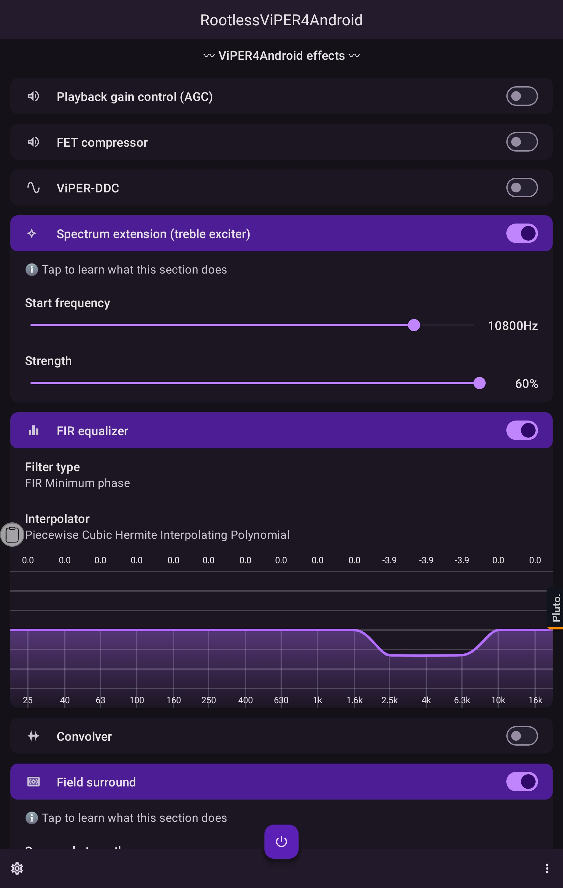
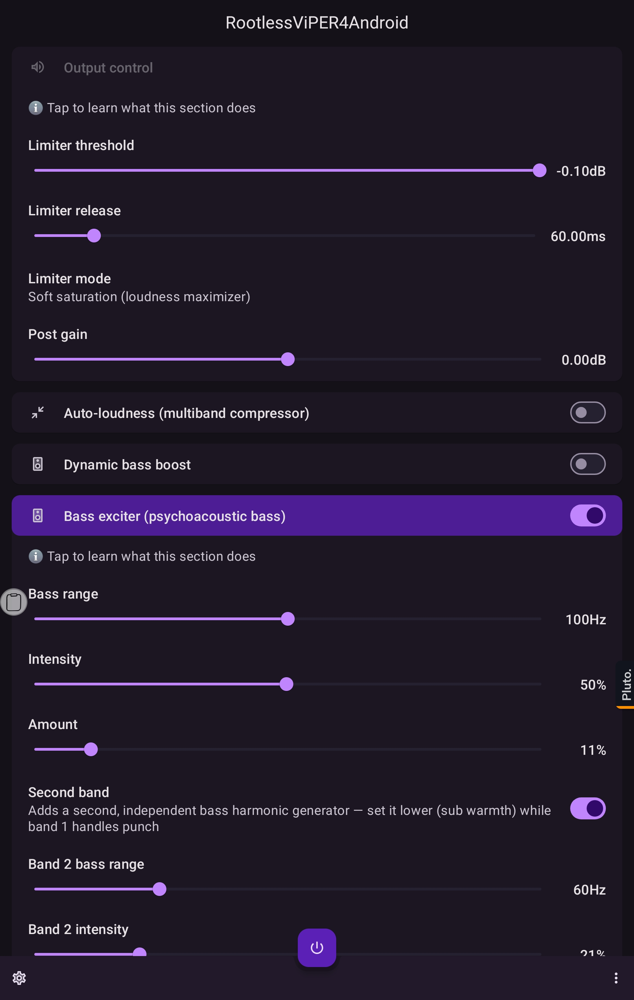
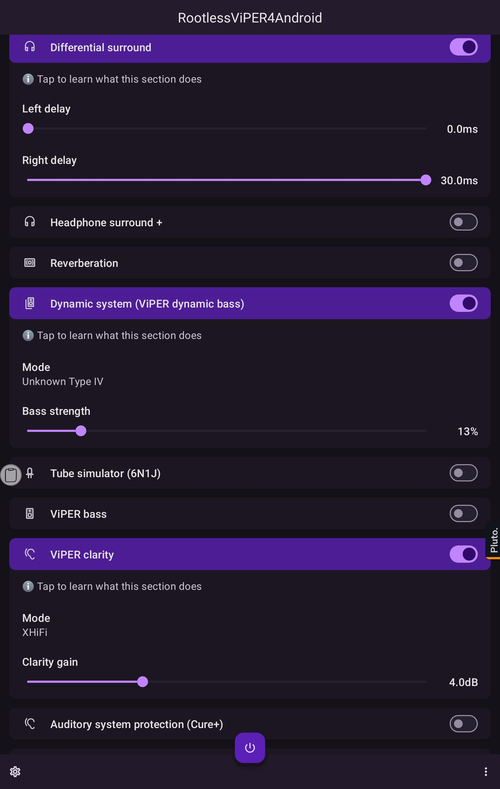

<h1 align="center">
  
   
  RootlessViPER4Android
   
</h1>
<h4 align="center">RootlessViPER4Android (RV4A): a RootlessJamesDSP fork ViPER4Android effects natively ported to Android. <b>No root required</b>.</h4>

  
  
  

  <a href="#features">Features</a> •
  <a href="#download--install">Download</a> •
  <a href="#limitations">Limitations</a> •
  <a href="#faq">FAQ</a> •
  <a href="#credits--thanks">Credits</a>

---

**RootlessViPER4Android** (RootlessJamesDSP, ViPER4Android Edition) is a system-wide **Android equalizer and audio effects app** that brings the beloved **ViPER4Android (V4A)** sound experience to **non-rooted phones**. It combines the powerful open-source **JamesDSP** engine with native re-implementations of ViPER's classic effects: Dynamic System, ViPER Bass, ViPER Clarity, Spectrum Extension, Field Surround, Tube Simulator (6N1J) and many more. All of it runs **without root, without Magisk, and without custom ROMs**.

Beyond the ViPER suite, it adds a **fully reorderable DSP chain**, so you decide the order every effect runs in, with the output limiter always kept last. An **interactive parametric equalizer** lets you drag bands directly on the response curve, add or remove them with a long press, and fine-tune frequency, Q and gain on rotary controls with full undo. A **studio-grade echo/delay** offers mono, stereo and ping-pong modes with a filtered feedback path, sample-rate and bit-depth crushing, tape-style modulation, diffusion and feedback distortion, all laid out on a knob panel that reflows to fit any screen. **Up to four Liveprog (EEL2) scripts** can be chained together and picked in one multi-select pass, and **446 official ViPER DDC profiles** are bundled and ready to load.

The interface is yours to arrange: **reorder, hide and group the effect cards**, search across every effect, and save the whole setup (including your layout and chain order) into portable presets. Effect cards load as you scroll so the app opens instantly, and large effect buffers are allocated only while an effect is switched on, keeping memory use modest even with many apps playing audio. Processing also stands down on its own once playback goes quiet, so nothing is spent grinding through silence while your music is paused.

The **Reverberation** effect offers six rooms (the classic ViPER model plus a smooth studio Plate, a large warm Concert hall, a natural Room with early reflections, and smooth versions of the hall and the room without the metallic ring), and the output stage adds a **ViPER classic limiter**, a faithful re-creation of the original V4A limiter with the lookahead and transient bite that made it distinctive. The **convolver and DDC libraries** have their own search, custom sorting, hiding and groups, and can pull fresh impulse responses and DDC profiles straight from public repositories, skipping anything you already own.

Prefer the original experience? **ViPER4Android-only mode** narrows the app to the effects V4A shipped, using its naming, its processing order and its limiter, and switches everything else off so it costs nothing. A matching **ViPER4Android classic theme** is available on its own too, if you want the classic look without giving up any of the extras.

## Screenshots

| ViPER effects & FIR EQ | Output control & Bass exciter | Surround, Dynamic system & Clarity |
|:---:|:---:|:---:|
|  |  |  |

## Features

### ViPER4Android effect suite (native ports)
Arranged in the classic V4A order:

| Effect | What it does |
|---|---|
| **Playback gain control (AGC)** | Evens out quiet/loud tracks automatically |
| **FET compressor** | Punchy studio-style compression |
| **ViPER-DDC** | Headphone correction profiles, **446 official DDC files bundled!** |
| **Spectrum extension** | Restores sparkle & air to compressed music |
| **FIR equalizer** | Precision fixed-band EQ |
| **Convolver** | Impulse response processing |
| **Field surround** | Widens the stereo field naturally |
| **Differential surround** | Classic V4A channel-delay surround |
| **Headphone surround +** | Speakers-in-a-room simulation for headphones |
| **Reverberation** | Full room reverb (size, damping, width, wet/dry) |
| **Dynamic system** | ViPER Dynamic Bass with all **19 original device presets** + custom mode |
| **Tube simulator (6N1J)** | Warm analog tube saturation (up to 24 dB drive) |
| **ViPER bass** | Natural / Pure Bass+ / Subwoofer modes |
| **ViPER clarity** | Natural / OZone+ / XHiFi treble enhancement |
| **Auditory system protection (Cure+)** | Anti-fatigue crossfeed for long sessions |
| **Speaker optimization** | Corrective tuning for phone speakers |

### Plus the full JamesDSP toolkit
Output limiter (with selectable peak / soft-saturation modes), auto-loudness compander, bass boost, **dual-band psychoacoustic bass exciter**, stereo widener, crossfeed, virtual room reverb, arbitrary-response graphic EQ (AutoEQ import), and a scriptable **Liveprog (EEL2)** engine.

### Quality-of-life
- Plain-language "ℹ️ what is this?" explainers on every section
- Smart UI: irrelevant sliders hide automatically
- Crash-safe DSP dispatch with built-in diagnostics
- Works per-app, session-based, with no audio HAL patching

## Added & changed vs. upstream RootlessJamesDSP

**Added in this fork:**
- **16 native ViPER4Android effect sections** (see table above), including brand-new engine code for Dynamic System, ViPER Bass, Clarity, FET Compressor, Cure+, Field/Differential/Headphone Surround, Reverberation, Spectrum Extension, AGC & Speaker Optimization
- **Dual-band psychoacoustic bass exciter**: two independently tunable harmonic bands (the second band hides until you enable it)
- **Selectable output limiter modes**: classic peak limiter, smooth **soft-saturation** (tanh) mode, or fully off
- **446 official ViPER-DDC correction files bundled** and auto-installed on first launch
- Collapsible plain-language explainers on every effect section
- Built-in crash diagnostics: native + JVM crash reports auto-copied to clipboard on next launch

**Changed & fixed:**
- **Tube simulator actually works now**: upstream divided the drive value by 100 before it reached the engine (max ≈ 0.12 dB, inaudible); fixed and range extended to **24 dB**
- Fixed a crash when seekbars use a `%` unit label
- Smart UI: Dynamic System custom sliders only appear in Custom mode; irrelevant controls stay hidden
- All ViPER-equivalent sections renamed to their **authentic V4A titles** and reordered into the classic V4A layout under a dedicated header
- App renamed to **RootlessViPER4Android** (installs alongside the original RootlessJamesDSP)
- From **v3.35.0** the package is this project's own: `com.alienware377.viper4android.rootless`, and `com.alienware377.viper4android.rootful` for the rooted build, which is now called **RootfulViPER4Android**. Earlier releases used upstream's `me.timschneeberger.rootlessjamesdsp`.

## Roadmap

### Shipped

- ~~**Reorderable DSP chain**~~: put the effects in any order you like
- ~~**Interactive parametric equalizer**~~: drag bands on the curve, rotary fine-tuning, live apply
- ~~**Full echo / delay unit**~~: ping-pong, filtered feedback, bit crushing, modulation, on its own knob panel
- ~~**Chained Liveprog scripts**~~: multi-select scripts, one card per script, chained in order
- ~~**Custom effect groups**~~: create, rename and delete groups, move cards between them, hide what you don't use
- ~~**More reverb room types**~~: Plate, Concert hall and Room alongside the classic ViPER model ([#1](https://github.com/alienware377/RootlessViPER4Android/issues/1))
- ~~**ViPER classic limiter**~~: a faithful re-creation of V4A's own limiter, lookahead and all
- ~~**ViPER4Android-only mode**~~: the original effect set, naming, processing order and limiter, with everything else switched off
- ~~**ViPER4Android classic theme**~~: the classic look, available with or without the mode
- ~~**Library management for Convolver & DDC**~~: search, sorting, hiding, groups, and downloading more profiles from public repositories
- ~~**Idle battery fix**~~: processing stands down when playback is silent, not just when apps release the audio session
- ~~**Multiband distortion**~~: pick frequency ranges to drive, with eight distortion characters, chorus, and a global mix, built on the interactive EQ editor with cutoff-type handles
- ~~**Full maximizer**~~: four limiting algorithms, with character, transient emphasis, true-peak detection, stereo linking and oversampling
- ~~**Search, sorting & hiding on the presets screen**~~: the same pull-down search, custom order, hiding and groups the convolver and DDC libraries have
- ~~**Linear / minimum phase toggle**~~: on both equalizer cards, since the two are merged into one filter before the engine sees them
- ~~**Dynamic EQ**~~: bands that only act while their own slice of the spectrum crosses a threshold, so taming a boom that happens on four notes no longer costs body on everything else; ships tuned for low boom, harshness and sibilance
- ~~**Multiband stereo imaging**~~: width chosen per frequency range rather than all at once, with a mono-below control, so the low end can be folded to the centre while the top opens up; mono recordings come through untouched
- ~~**Impact (attack & sustain)**~~: shapes how a note starts and how long it takes to die rather than how loud it is, per frequency range, so a held tone is left completely untouched while a drum hit can be sharpened or softened
- ~~**Low end**~~: a steep subsonic filter to stop inaudible rumble eating headroom, one knob for body, and a wide dip where recordings turn thick (mono-below lives in the imaging card and punch in Impact, so neither is duplicated)
- ~~**Soft clipper**~~: three curves for the maximizer's Character control, from one that bends immediately and adds density to one that stays linear until the very top and only clips peaks; a shape inside the maximizer rather than a second thing doing the limiter's job
- ~~**Mid/side modes**~~: the dynamic EQ can be pointed at the centre of the image or at its edges, so a de-esser can catch a vocal without dulling the reverb around it; the untouched half comes through bit-for-bit
- ~~**Exciter**~~: four ranges, each with its own amount, and five characters: three symmetrical ones that add odd harmonics and two lopsided ones that add even harmonics, which is the difference between a transistor sound and a valve one. The older two-band Bass exciter card is left in place so existing setups keep working
- ~~**Vintage tape**~~: wow and flutter as a genuinely modulated delay rather than a phase trick, gentle tape saturation, a bias control that runs the right way round (down is brighter and grittier, up is duller), and the head bump that makes tape masters sound weightier
- ~~**Rooted mode**~~: a Magisk module carrying this fork's own engine as a system-wide audio effect, so rooted devices run these effects rather than the stock JamesDSP set. Ships as **RootfulViPER4Android**, a separate app that installs alongside the rootless one. Legacy effect HAL, so Android 14 and below
- ~~**Per-channel parametric EQ**~~ *(v4.4.0)*: each band can act on the left ear, the right ear or both, for correcting a pair of earphones whose sides do not match. Imports and exports EqualizerAPO's `Channel:` lines ([#9](https://github.com/alienware377/RootlessViPER4Android/issues/9))
- ~~**Choose which apps are processed**~~ *(v4.4.0)*: the app list can name the apps to process instead of the ones to skip ([#10](https://github.com/alienware377/RootlessViPER4Android/issues/10))
- ~~**Remember effect on/off states**~~ *(v4.4.0)* across a ViPER4Android-only mode round trip: switching the mode off now puts back exactly the effects that were on before
- ~~**Smooth Concert hall and Room**~~ *(v4.4.0)*: rebuilt versions of the two reverbs that sounded metallic, with a dense tail and no repeating echoes. The originals stay, so existing presets sound the same ([#6](https://github.com/alienware377/RootlessViPER4Android/issues/6))
- ~~**GitHub search for new profile sources**~~ *(v4.5.0)*: "Download more..." in the convolver and DDC libraries can now search GitHub, starting from repositories tagged viper4android and a short suggested list. Results show archived repositories and forks, a file list can be filtered, ticked and sized before anything is downloaded, and every file is checked against the repository before it is kept. Repositories too big to list at once ask for a folder, and sources you add are no longer replaced when a preset or device profile loads
- ~~**Match EQ**~~ *(v4.5.0)*: pick your headphones from the AutoEQ database or load a measurement, pick a target sound, and the graphic EQ gets the curve that takes one to the other. Bass, treble and tilt adjustments, limits on boost and cut, and a guard against filling narrow dips. Uses the same method and defaults as AutoEq, and nothing is downloaded until you pick it
- ~~**Spectral shaper**~~ *(v4.5.0)*: finds frequencies that suddenly stick out of their surroundings, like a harsh cymbal or a sharp peak in bright IEMs, and turns them down only while they do. Clean steady notes are left alone, with a switch to catch those too, and "Listen to what is removed" plays only what it takes away. Adds about 21 ms of delay at 48 kHz and 23 ms at 44.1 kHz
- ~~**Global "Poweramp-style" mode**~~ *(v4.5.0, experimental)*: global mode, in Settings, changes the sound with Android's own built-in effect instead of recording it, so there is no recording prompt and apps that block recording (Spotify) work too. It can change all sound or each app separately. Only the Multiband, Graphic (including AutoEq and Match EQ) and Parametric EQ, Bass boost, FET compressor, Maximizer, Output control and Balance carry over; the other cards are greyed out while it is on and keep their settings. Adds about 40 ms of delay, depends on the phone (Google calls this route deprecated, and some phones ignore it), and a check screen shows what Android did with it
- ~~**Binaural upmix**~~ *(v4.5.0)*: places ordinary stereo around you on headphones. The room sound of the recording goes to the sides, behind you and a little above, the main sound stays in front, and a mono centre stays exactly in the centre. Built on a measured dummy head (MIT KEMAR), or load your own SOFA file of head measurements. Width, Surround, Height and a small Room, and it switches itself off on the phone speaker. Headphones only; adds about 22 ms of delay
- ~~**Graphic EQ files and conversion**~~ *(v4.6.0)*: the graphic EQ imports and exports the `GraphicEQ:` lines AutoEq and Equalizer APO use, and "To parametric EQ" fits up to 20 parametric bands to the curve, says how close they come, and applies them to the parametric EQ or copies them as an Equalizer APO preset
- ~~**LUFS normalizer**~~ *(v4.6.0)*: keeps the volume even from one song to the next by measuring loudness the way streaming services do (ITU-R BS.1770) and slowly turning towards a target. It never turns up in a pause, and a gap between songs lets go of a boost so the next one is judged on its own
- ~~**Loudness correction**~~ *(v4.6.0)*: puts back the bass and treble your ears lose as the volume goes down, by as much as it went down, following the media volume. Equalizer APO's classic method or the ISO 226:2023 equal-loudness contours; it never boosts, and at the reference volume it does nothing
- ~~**Smooth volume**~~ *(v4.6.0)*: half dB volume steps, about two hundred from full to silence instead of Android's fifteen or so. The volume keys, the card and a quick settings tile move a fine level while the system volume is held, with an optional on-screen level, and switching off puts the system volume back
- ~~**Voice isolation**~~ *(rootless, v4.6.0)*: a small speech model (GTCRN) on the phone finds the voice in whatever is playing, so the rest can be turned down for clearer dialogue, or the voice itself for karaoke. Needs the separate voice isolation add-on (ARM phones), and adds about 34 ms of delay
- ~~**Sub-harmonic expander**~~ *(v4.6.0)*: adds notes an octave and more below the bass, locked to the bass line at half, a third and a quarter of its pitch, the way a subwoofer that is not there would. Nothing lands below about 20 Hz

### Planned

- **AIDL effect HAL**: a second module for Android 15 and newer, where the effect framework moved from the legacy plugin interface to a binder service. Not a port of the existing one: the engine has to be exposed behind a new interface and driven from fast message queues rather than a process callback
- **Turntable music player (separate paid app)**: a music player whose now-playing screen is a vintage turntable, with independent tempo and pitch control as well as combined speed, and period defects such as wow, flutter and surface noise as adjustable colour. It will be its own paid app with effects written fresh, so it shares no code with this one, and it plays nicely alongside it. This app stays free and open source.
- **Effect suite for PCs (VST3)**: a separate paid plugin that brings this app's effect cards to music software on Windows, with the same card screen: groups, hiding, collapsing, search and a reorderable processing order. Its effects are written fresh rather than copied from this app, so some will sound a little different, and a few that depend on other people's code or data (such as DDC profiles and Rubber Band) will not be included. This app stays free and open source.
- **Windows app** *(after the VST3 suite)*: a separate paid desktop app using the same effects and card screen as the VST3 suite, plus more of this app's features, such as device profiles, a file library for impulse responses and scripts, and backup and restore. System-wide processing will start with a simple routing setup, with deeper Windows integration looked at later.

## Download & Install
1. Grab the latest APK from the [**Releases**](https://github.com/alienware377/RootlessViPER4Android/releases) page (or fresh builds from [Actions](https://github.com/alienware377/RootlessViPER4Android/actions)).
2. Install and follow the in-app onboarding. It walks you through the permission setup step-by-step.
3. Play music, open the app and switch on the effects you want.

Installs **alongside** the original RootlessJamesDSP as a separate app. Keep both or remove the original, your choice.

> ### ⚠️ Upgrading from v2.8.2 or earlier
> v3.35.0 changes the package name, so Android treats it as a new app: it **installs alongside your existing copy instead of updating it**, and settings do not carry across on their own.
>
> **Back up first.** In the old app: *Settings → Backup & restore → Create backup*. Install v3.35.0, then restore that file in the new app. Your presets, card layout and every effect setting come across intact. Once you are happy, uninstall the old one.

Want **Voice isolation**? It also needs the small **voice isolation add-on** (`RootlessViPER4Android-voice-isolation-addon-*.apk`) from the same release. It carries the speech model and the engine that runs it, so the app stays small for everyone who never switches that card on, and the card links to it when it is missing.

Rooted? Grab **RootfulViPER4Android** and the Magisk module from the same release. It is a separate app again, so it sits happily beside the rootless build.

## Limitations
Rootless audio capture on Android has inherent restrictions (inherited from upstream RootlessJamesDSP):
* Apps that block internal audio capture (some streaming apps, e.g. Spotify) are not processed, unless you switch on the experimental global mode, which supports fewer effects
* Calls and protected media may bypass processing
* A persistent capture notification is required by Android

See the [upstream documentation](https://github.com/timschneeberger/RootlessJamesDSP) for details and workarounds.

## FAQ
**Is this really ViPER4Android?**
The original V4A is closed-source and requires root. This project re-implements its most-loved effects natively on top of the JamesDSP engine. Same spirit, same workflow, zero root.

**Do I need Magisk / a custom kernel / a driver install?**
No. The rootless app needs nothing flashed, no driver and no SELinux changes. The Magisk module is only for the separate RootfulViPER4Android build on rooted phones.

**Will it work on Android 13/14/15?**
It targets modern Android and is tested on current versions. If something breaks, open an issue with the in-app crash report.

## Credits & Thanks
This fork stands entirely on the shoulders of giants. Thank you!

* **[James Fung (@james34602)](https://github.com/james34602)**: creator of **[JamesDSP](https://github.com/james34602/JamesDSPManager)**, the brilliant open-source audio engine powering every effect here
* **[Tim Schneeberger (@timschneeberger)](https://github.com/timschneeberger)**: creator of **[RootlessJamesDSP](https://github.com/timschneeberger/RootlessJamesDSP)**, which made system-wide DSP without root a reality and is the direct base of this fork
* **The ViPER's Audio team (ViPER520 & zhuhang)**: creators of the legendary **[ViPER4Android](https://github.com/vipersaudio)**, whose effect designs inspired every port in this edition
* All upstream contributors and translators of both projects

## Privacy

The app collects no personal data, contains no analytics or tracking, and processes all audio locally on your device. See [PRIVACY.md](PRIVACY.md) for the full policy.

## License
This project is licensed under **GPL-3.0**, same as upstream RootlessJamesDSP. See [LICENSE](LICENSE). ViPER4Android is a trademark of its respective owners; this project is an independent, unaffiliated re-implementation.

---
Keywords: ViPER4Android no root, V4A without root, rootless equalizer Android, system-wide equalizer, JamesDSP fork, Android audio effects, bass boost, DDC headphone correction, AutoEQ, spectrum extension, tube amp simulator
